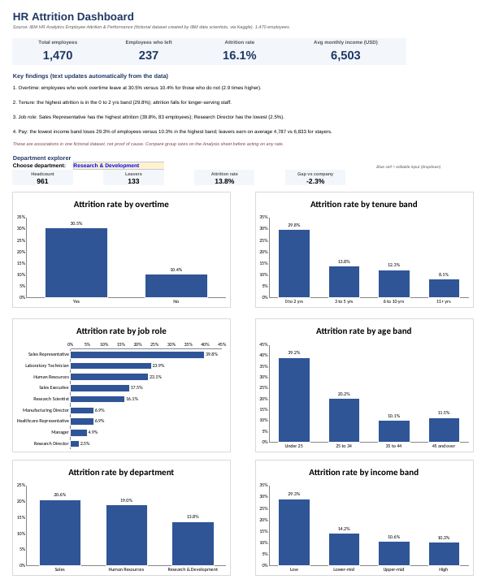

# HR Attrition Analysis Dashboard (Excel)

An Excel workbook that analyses which employees leave and which factors are associated with attrition, with a one-page dashboard.

## Dataset
IBM HR Analytics Employee Attrition & Performance (Kaggle): 1,470 employees, 35 columns.
**This is a fictional dataset created by IBM data scientists.** Results describe this dataset only, not a real company.
Source: https://www.kaggle.com/datasets/pavansubhasht/ibm-hr-analytics-attrition-dataset (check the license on the Kaggle page).

## Key findings (all numbers come from the workbook formulas)
- **Overall attrition:** 237 of 1,470 employees left (16.1%).
- **Overtime:** 30.5% of employees who work overtime left, versus 10.4% of those who do not (2.9 times higher).
- **Tenure:** attrition is highest in the first two years (29.8%) and falls to 8.1% after 11+ years.
- **Job role:** Sales Representative has the highest attrition (39.8%, 83 employees) and Research Director the lowest (2.5%, 80 employees).
- **Age:** employees under 25 leave at 39.2%, against 10.1% for ages 35 to 44.
- **Pay:** the lowest income quartile loses 29.3% of employees versus 10.3% in the highest; leavers earned 4,787 on average against 6,833 for stayers.
- **Other factors:** single employees (25.5%) and frequent business travellers (24.9%) have higher attrition.

## Cleaning steps
1. Checked missing values (0) and duplicates (0 duplicate rows, 0 duplicate EmployeeNumber).
2. Removed 3 constant columns: EmployeeCount (always 1), StandardHours (always 80), Over18 (always Y).
3. Loaded the remaining 32 columns as an Excel Table `tblHR`.
4. Added 5 helper columns as formulas: LeftFlag, AgeBand, TenureBand, IncomeBand (quartiles), LowSatFlag.

## Workbook structure
| Sheet | Contents |
|---|---|
| Read Me | Purpose, data, cleaning, limitations |
| Dashboard | KPI cards, auto-updating key findings, department dropdown, 6 charts |
| Analysis | Attrition by 9 factors: headcount, leavers, rate, gap vs company, small-group flag |
| KPIs | Headline numbers with how each is calculated |
| Settings | Income quartile cut-offs, band definitions, minimum group size |
| Data | Cleaned table with formulas |

Excel features used: Tables, COUNTIFS, SUMIFS, AVERAGEIFS, nested IF, OR, IFERROR, INDEX/MATCH, QUARTILE, TEXT, data validation (dropdown), conditional formatting, charts. The workbook contains 7,500+ live formulas.

## Limitations
- Fictional data; findings are associations, not causes.
- Some groups are small (the Analysis sheet flags groups under 30 employees).
- No statistical significance tests were run.
- Summary tables are formula-based, not PivotTables, and there are no slicers.

## Recommendations (to discuss, not proven)
- Review workload and overtime policy, since overtime shows the largest gap.
- Improve onboarding and early-career support in the first two years.
- Review pay and roles in the highest-attrition groups (for example Sales Representative).

## Author
Muhammed Irfan M A | https://github.com/irfan564 | https://www.linkedin.com/in/muhammed-irfan-911208251
